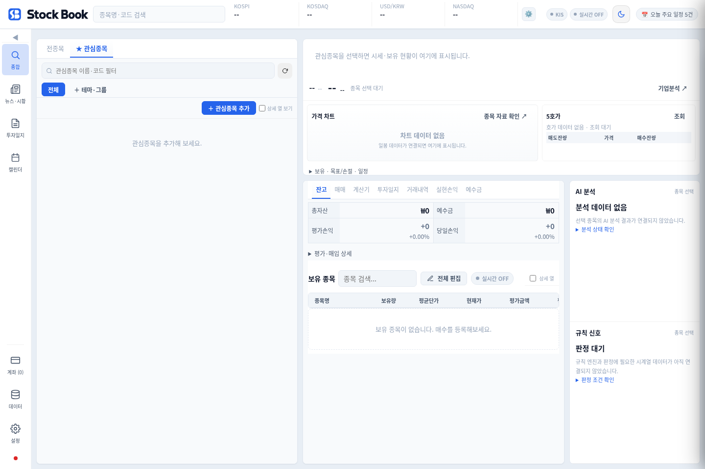
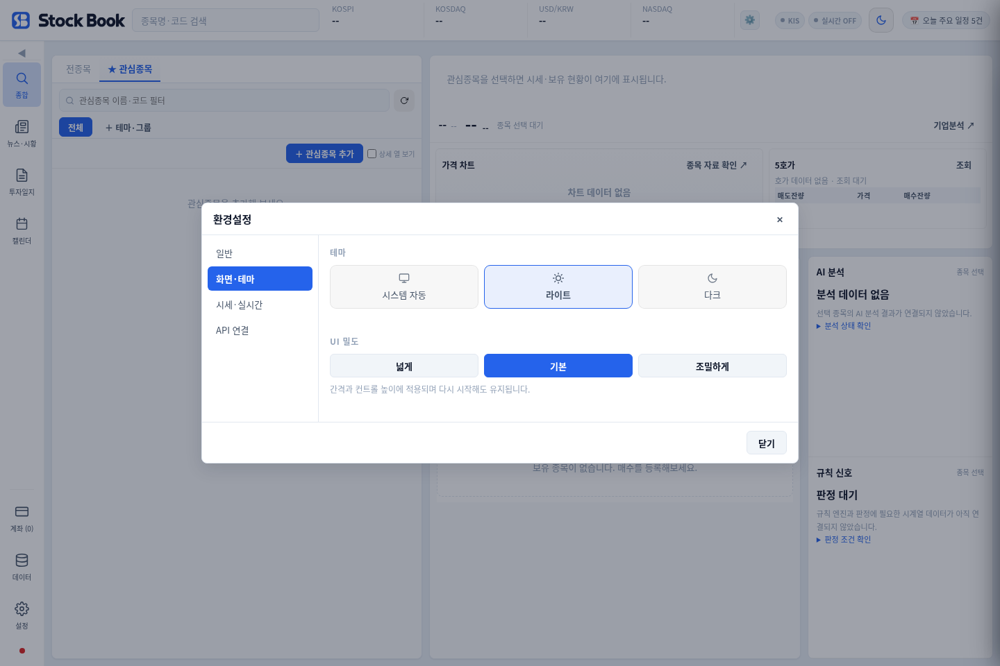
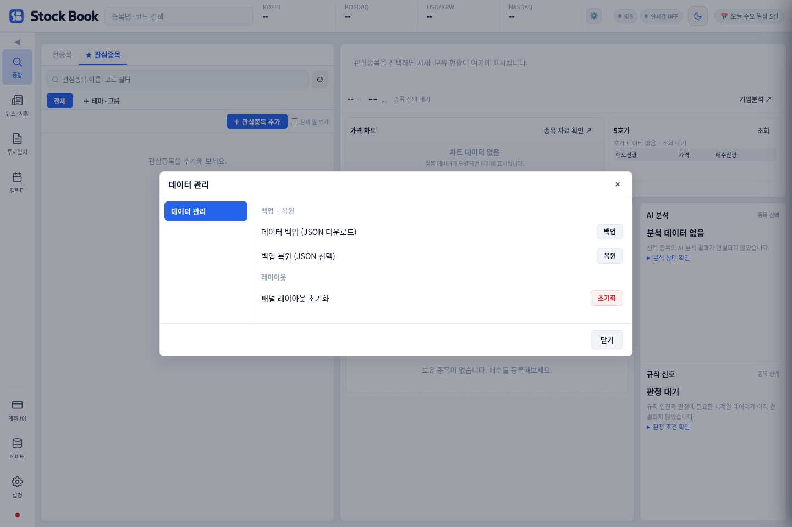

# StockBook 사용 매뉴얼

주식의 관심종목, 보유 잔고, 거래 기록과 투자일지를 한곳에서 관리하는 프로그램입니다. 이 문서는 현재 저장소의 PC 화면을 기준으로 작성했습니다. 설치된 앱과 메뉴 배치가 다를 수 있으므로 설치 파일과 화면을 함께 확인하세요.

**처음 사용한다면 아래 ‘처음 시작하기’부터 따라 하세요.** 개발 도구나 서버 가입은 필요하지 않습니다.

## 목차

- [처음 시작하기](#처음-시작하기)
- [화면과 메뉴](#화면과-메뉴)
- [관심종목과 종목 선택](#관심종목과-종목-선택)
- [계좌와 API 연결](#계좌와-api-연결)
- [잔고와 예수금](#잔고와-예수금)
- [매매 기록과 거래내역](#매매-기록과-거래내역)
- [계산기](#계산기)
- [투자일지](#투자일지)
- [뉴스와 일정](#뉴스와-일정)
- [설정](#설정)
- [저장·백업·복원](#저장백업복원)
- [문제가 생겼을 때](#문제가-생겼을-때)
- [현재 기능 범위](#현재-기능-범위)

## 처음 시작하기

### 설치 또는 웹 실행

Windows에서는 [GitHub Releases의 설치 파일](https://github.com/mj94920/stockbook/releases/latest)을 내려받아 설치하고 실행합니다. Windows 앱은 Electron 기반입니다.

설치 없이 보려면 [웹 화면](https://mj94920.github.io/stockbook/)을 사용할 수 있습니다. 다만 웹은 증권사 연결, 시세·뉴스 수신 등 데스크톱 전용 기능이 제한됩니다. Windows 앱과 웹의 저장 자료도 자동으로 공유되지 않습니다.

### 처음 할 일 다섯 가지

1. **설정 → 화면·테마**에서 밝기와 화면 밀도를 선택합니다.
2. **종합 → 관심종목 → ＋ 관심종목 추가**에서 확인할 종목을 넣습니다.
3. 계좌별로 관리하려면 왼쪽 **계좌**에서 계좌를 등록합니다. 계좌 등록과 증권사 API 연결은 다른 작업입니다.
4. 종목을 선택하고 하단 **잔고·매매·투자일지** 탭을 이용합니다. 이미 보유한 수량을 입력한 뒤 같은 매수를 다시 기록하면 중복 반영될 수 있으니 한 번만 반영되었는지 확인합니다.
5. 사용을 마치기 전 **데이터 → 백업**으로 JSON 파일을 보관합니다.

API 키가 없어도 수동 기록 기능부터 사용할 수 있습니다. 첫 실행의 연결 안내를 닫았다고 해서 웹 회원가입이나 증권사 로그인이 완료되는 것은 아닙니다.

## 화면과 메뉴

아래 화면은 새 브라우저의 빈 데이터 상태에서 찍었습니다. 실제 계좌정보가 없습니다. 시세·계좌 연결이 안 된 상태의 빈 영역도 그대로 보입니다.

### 화면의 네 영역

| 위치 | 하는 일 |
|---|---|
| 왼쪽 메뉴 | 종합, 뉴스·시황, 투자일지, 캘린더로 이동. 아래쪽에는 계좌·데이터·설정 |
| 상단 | 종목 검색, 시장 지표, 연결 상태, 테마 등 확인 |
| 종합 왼쪽 | 전종목·관심종목 목록, 필터·그룹, 종목 선택 |
| 종합 오른쪽 | 선택 종목 요약과 하단 작업 탭. AI·규칙 영역은 데이터 연결 상태 확인 |

작은 창에서는 내용이 패널 안으로 접히거나 스크롤될 수 있습니다. 메뉴 글자가 안 보이면 사이드바 접기/펼치기 버튼을 확인합니다.

### 하단 공통 작업 탭

| 탭 | 용도 |
|---|---|
| 잔고 | 보유종목과 평가 현황 확인 |
| 매매 | 매수·매도 기록 입력, 수신된 호가 확인 |
| 계산기 | 복리와 추가 매수 후 평균단가 계산 |
| 투자일지 | 매수·매도 이유와 결과 기록 |
| 거래내역 | 저장된 거래 기록 조회, CSV 내보내기 |
| 실현손익 | 기록된 매도에 따른 실현손익 확인 |
| 예수금 | 등록 계좌의 저장된 예수금 확인·관리 |

포트폴리오·매매가 왼쪽에 별도 메뉴로 안 보이는 경우 하단 공통 작업 탭을 사용하세요.

## 관심종목과 종목 선택

### 관심종목 추가

1. 왼쪽 **종합**을 엽니다.
2. **관심종목** 탭에서 **＋ 관심종목 추가**를 누릅니다.
3. 원하는 테마·그룹을 선택하고 종목명 또는 코드로 찾습니다.
4. 목록이 없으면 시장을 선택해 **선택 시장 종목 불러오기**를 누릅니다. 이 조회는 데스크톱 연결이 필요합니다.
5. 검색 결과의 종목을 눌러 추가합니다. 목록에 없다면 추가 창의 **목록에 없는 종목 직접 입력**에서 6자리 국내 코드와 이름을 입력할 수 있습니다.

목록 위의 **관심종목 이름·코드 필터**는 이미 등록한 항목을 좁혀 보는 입력창입니다. 여기에 이름을 썼다고 관심종목이 새로 추가되지는 않습니다.

### 그룹과 상세 열

- **＋ 테마·그룹**으로 그룹을 만듭니다.
- 종목 옆 그룹 선택에서 배정합니다.
- 그룹 버튼으로 해당 종목만 보거나 **전체**로 돌아옵니다.
- **상세 열 보기**를 켜면 숨겨진 추가 열을 확인할 수 있습니다.
- 관심 해제는 관심목록에서 빼는 작업입니다. 보유종목의 실제 매도와 같은 의미가 아닙니다.

현재 그룹 기능은 단일 그룹 분류입니다. 업종·세부산업·태그를 자유롭게 여러 개 붙이는 새 분류 체계로 확대된 상태는 아닙니다.

### 선택 종목과 가격 상태

종목 행을 선택하면 오른쪽 요약과 관련 작업의 종목이 바뀝니다. 매매·뉴스를 사용 중이면 그 화면의 선택 종목도 확인하세요.

`--`, `연결 필요`, `조회 실패`, `호가 미수신`은 자료가 없거나 조회되지 않았다는 뜻입니다. 가격이나 호가가 0이라는 뜻이 아닙니다. 화면의 마지막 조회 시각과 연결 상태를 함께 확인하세요.

## 계좌와 API 연결

### 계좌 등록

1. 왼쪽 **계좌**를 누릅니다.
2. 계좌 추가에서 증권사, 알아보기 쉬운 별칭, 필요한 계좌 정보와 종류를 입력합니다.
3. 저장하고 목록에 표시되는지 확인합니다.
4. 기록을 입력할 때 해당 계좌를 선택합니다.

수동 계좌를 등록해도 증권사 잔고가 자동으로 조회되지는 않습니다. 여러 증권사 선택 항목이 보인다고 모든 증권사의 자동 연동이 완성된 것은 아닙니다.

### 한국투자증권 API 연결

1. **설정 → API 연결**로 이동합니다.
2. 한국투자증권 카드를 선택합니다.
3. KIS Developers에서 발급받은 본인의 APP Key·Secret과 필요한 계좌 정보를 입력합니다.
4. 저장 후 연결 상태와 실제 조회 결과를 확인합니다.

키는 채팅·공개 저장소·문제 신고 캡처에 넣지 마세요. 데스크톱 앱은 별도 암호화 저장 기능을 사용합니다. 연결 성공 여부는 실제 시세·잔고 수신 결과로 확인합니다. 웹에서는 데스크톱과 같은 키 저장·계좌 연동을 기대하면 안 됩니다.

현재 사용 안내의 중심은 구현된 KIS 연동과 수동 관리입니다. 다른 증권사의 버튼이나 입력창은 구현 범위가 다를 수 있습니다. 실제 주문 기능까지 된다고 해석하지 마세요.

### 로그인이라는 말의 의미

설정의 **시작 시 자동 로그인**은 저장된 API 키가 있을 때 시작 안내를 건너뛰는 앱 설정입니다. StockBook의 새 서버 회원가입이나 Firebase 계정 로그인을 뜻하지 않습니다. Firebase 동기화는 현재 이 프로그램에 연결하지 않았습니다.

## 잔고와 예수금

### 잔고

하단 **잔고**에서 보유종목, 수량, 평균단가, 평가 현황을 확인합니다. 상세 열을 켜면 추가 항목을 볼 수 있습니다. 입력·수정 후에는 수량·평균단가·계좌가 맞는지 확인하세요.

현재가를 받지 못하면 평가손익도 실제 증권사와 일치한다고 볼 수 없습니다. 표시된 금액은 프로그램에 저장된 기록과 수신 가격을 바탕으로 한 결과입니다. 증권사 원장과 대조할 때는 같은 종목·계좌·가격 시점을 사용합니다.

### 예수금

하단 **예수금**에서 계좌별 저장된 예수금을 보고 **계좌 관리** 또는 **예수금 설정**으로 이동합니다. 수동 계좌는 저장값을 관리하고, KIS 연동 계좌는 자동 동기화 동작을 확인합니다.

수동 입력값과 증권사 잔고를 섞어 볼 때는 출처를 확인하세요. 현재 구조에는 기존 합계·폴백 계산이 남아 있으며, 설계 문서의 새 계좌·장부 시스템이 모두 적용된 상태는 아닙니다. 예수금 화면을 증권사 결제 가능 금액의 확정값으로 단정하지 않습니다.

## 매매 기록과 거래내역

**‘매수 기록’과 ‘매도 기록’은 프로그램의 장부 기록입니다. 실제 증권사 주문을 제출하는 버튼이 아닙니다.**

### 매수 기록

1. 관심종목에서 종목을 고르고 하단 **매매**를 엽니다.
2. 계좌, **매수**, 현금·신용 구분을 선택합니다.
3. 단가와 수량을 입력합니다. 예: 단가 1,000원 × 수량 10주 = 10,000원.
4. 합계를 확인하고 **매수 기록**을 누릅니다.
5. **잔고**의 수량·평균단가, **거래내역**을 확인합니다. 투자일지 초안이 생길 수 있습니다.

기록을 저장하면 기존 보유 수량·평균단가, 선택 계좌의 저장된 예수금 등에 영향을 줍니다. 테스트로 실제 계좌 데이터를 중복 입력하지 마세요.

### 매도 기록

**매도**를 선택하고 보유종목, 계좌, 단가·수량을 확인한 뒤 기록합니다. 보유 수량보다 많은 매도는 거절될 수 있습니다. 저장 후 잔고·거래내역·실현손익을 함께 확인합니다.

### 호가

실제 호가가 수신된 경우 가격을 선택해 기록 단가에 넣을 수 있습니다. 단가는 저장 전에 다시 확인합니다. 호가 미수신 시 임의 잔량을 실제 호가처럼 표시하지 않습니다.

### 거래내역과 CSV

하단 **거래내역**에서 저장된 기록을 확인합니다. **CSV 내보내기**로 거래 기록을 표 형태로 받을 수 있습니다. CSV는 전체 프로그램 백업과 다릅니다. 복원용으로는 **데이터 → 백업**의 JSON을 사용하세요.

## 계산기

하단 **계산기**에서 사용할 수 있습니다.

| 계산기 | 입력·결과 |
|---|---|
| 복리 계산기 | 초기 원금, 월 수익률, 투자 기간, 월 추가 납입, 시작일을 입력하고 계산 |
| 물타기 계산기 | 기존 평균단가·수량과 추가 매수 가격·수량으로 새 평균단가 계산 |

월 수익률은 가정값입니다. 계산 결과가 실제 수익을 보장하지 않습니다. 계산만 해도 거래가 기록되거나 증권사에 주문이 나가는 것은 아닙니다.

## 투자일지

1. 왼쪽 **투자일지** 또는 하단 같은 이름의 탭을 엽니다.
2. 필수 항목인 **매수일·종목명·매도/매수**를 입력합니다.
3. 가격·수량, 추가 매수·매도일, 목표가·손절가, 진입 이유, 결과와 교훈 등을 필요한 만큼 기록합니다.
4. 저장 후 목록에서 내용을 확인합니다.

기존 종목을 연결하려면 목록에서 사용하는 종목명을 정확히 확인합니다. 날짜를 수정하면 연결된 거래 기록의 날짜에도 반영될 수 있으므로 수정 뒤 거래내역도 확인하세요.

매매 화면에서 만들어진 초안이 있으면 그 내용을 이어 작성해 중복 일지를 줄입니다. 목표가·손절가 입력은 기록·표시용이며 증권사 자동 주문 예약이 아닙니다.

## 뉴스와 일정

### 뉴스·시황

왼쪽 **뉴스·시황**에서 시장뉴스·종목뉴스·공시·경제지표를 선택합니다.

종목뉴스를 보려면 종목 입력에서 국내 종목명 또는 6자리 코드를 선택하고 **종목 뉴스 보기**를 누릅니다. 관심목록의 종목을 바꿨다면 종목 입력·안내와 기사 목록이 맞는지도 확인합니다.

**기사 검색**은 받은 기사의 제목·요약·출처를 필터링합니다. 인터넷 전체의 기사를 새로 검색하는 기능은 아닙니다. 기사 목록을 선택하면 상세를 보고, 필요한 경우 원문으로 이동합니다.

뉴스 수신은 데스크톱 전용 경로가 있습니다. 웹에서 데스크톱 연결 안내가 나오면 외부 사이트 바로가기를 이용합니다. 공시·경제지표 항목의 자료 범위나 외부 링크를 모든 공급자의 실시간 원문 수집으로 해석하지 않습니다.

### 캘린더

왼쪽 **캘린더**에서 시장 일정 센터를 열고 날짜·일정과 경제지표 항목을 확인합니다. 표시 항목의 출처와 갱신 상태를 확인하고, 누락된 일정이 없다는 보장으로 사용하지 않습니다.

## 설정

**설정**은 일반 환경설정, **계좌**는 계좌 관리, **데이터**는 백업·복원입니다.

| 항목 | 하는 일 |
|---|---|
| 일반 | 시작 시 자동 로그인 안내 설정 |
| 화면·테마 | 시스템 자동·라이트·다크, 화면 밀도 넓게·기본·조밀하게 |
| 시세·실시간 | KIS 실시간 구독 우선순위 확인·조정 |
| API 연결 | 증권사별 연결 설정과 키 입력 |

실시간 시세는 구독 가능한 종목 수가 제한됩니다. 기본 우선순위는 보유종목 → 선택 종목 → 관심종목 → 기타입니다. 모든 종목이 동시에 실시간으로 갱신된다고 생각하지 마세요.

준비 중인 빈 설정 메뉴는 일반 탐색에서 숨겨져 있습니다. 화면에 없는 설정을 찾기 위해 앱 데이터를 초기화할 필요는 없습니다.

## 저장·백업·복원

### 평소 저장

입력 화면의 저장·기록 버튼을 누르면 프로그램 상태가 저장됩니다. 데스크톱은 로컬 데이터 파일, 웹은 해당 브라우저의 저장 공간을 사용합니다. 웹의 사이트 데이터 삭제, 다른 브라우저·다른 기기 사용 시 같은 자료가 자동으로 나타나지 않습니다.

PC·휴대폰 동기화나 서버 백업은 현재 연결된 기능이 아닙니다. 데이터가 중요한 시점에는 별도 JSON 백업을 보관하세요.

### 백업 만들기

1. 왼쪽 **데이터**를 엽니다.
2. **데이터 백업 (JSON 다운로드)**의 **백업**을 누릅니다.
3. 내려받은 `stockbook_backup_날짜_시간.json`을 확인합니다.
4. 앱을 설치한 PC 외의 안전한 저장 위치에도 복사합니다.

백업에는 계좌 별칭·보유종목·거래·일지 등 개인 투자 정보가 포함될 수 있습니다. 공개 GitHub에 올리거나 문제 신고에 그대로 첨부하지 마세요. 증권사 인증은 별도 암호화 파일로 관리되므로 JSON 복원만으로 API 연결까지 복구된다고 가정하면 안 됩니다.

### 복원

**복원은 기존 기록과 합치는 동작이 아니라 현재 데이터를 덮어쓰는 동작입니다.**

1. 먼저 현재 데이터를 새 백업 파일로 보관합니다.
2. **데이터 → 복원**에서 복원할 JSON을 선택합니다.
3. 표시되는 포트폴리오·거래기록·투자일지 수량을 확인합니다.
4. 맞는 파일일 때만 복원을 승인합니다.
5. 완료 후 잔고·거래·일지를 확인하고 필요한 API 연결 상태도 확인합니다.

CSV나 차트 실험용 JSON을 백업 복원에 넣지 마세요.

### 패널 레이아웃 초기화

**데이터 → 패널 레이아웃 초기화**는 화면 배치를 되돌리기 위한 기능입니다. 투자 기록을 삭제하는 기능과 구분하세요. 메뉴가 가려지거나 패널 배치가 이상할 때 백업을 보관한 뒤 사용합니다.

## 문제가 생겼을 때

| 현상 | 먼저 확인할 것 |
|---|---|
| 관심종목 검색 결과가 없음 | 그룹·필터를 전체로 되돌리고, 새 종목 추가는 별도 추가 창 사용 |
| 현재가·호가가 없음 | 연결 상태·마지막 수신 시각·종목코드 확인. 임의 가격으로 기록하지 않기 |
| 웹에서 뉴스·계좌가 안 됨 | 데스크톱 전용 기능인지 확인 |
| 잔고나 예수금이 예상과 다름 | 중복 기록, 수량·평균단가·선택 계좌·수동 입력 여부 확인. 증권사 자료와 대조 |
| 매도 기록이 거절됨 | 해당 종목의 등록 보유 수량과 현금·신용 구분 확인 |
| 화면이 너무 조밀함 | 창 크기·패널 스크롤·화면 밀도·사이드바 접힘 확인 |
| 다른 PC에서 데이터가 없음 | 자동 동기화가 연결되지 않았으므로 백업 JSON으로 이동 |
| 백업 복원이 안 됨 | StockBook 전체 백업 JSON인지 확인. 먼저 현재 자료를 보존 |
| 가격 차트·AI·규칙에 데이터 없음 | 아래 기능 범위 확인. 설정을 잘못했다는 의미로 단정하지 않기 |

문제를 전달할 때는 어떤 메뉴에서 무엇을 눌렀는지, 기대한 결과와 실제 결과를 적습니다. 캡처의 계좌번호·별칭·키·토큰은 가립니다. 반복 입력으로 기록을 바꾸기 전에 백업을 만드세요.

## 현재 기능 범위

| 구분 | 현재 안내 |
|---|---|
| 관심종목·수동 계좌·잔고·거래·일지 | 프로그램에서 사용 가능한 기록·관리 기능 |
| KIS 시세·계좌·호가 | 연결과 제공 서비스 상태에 따라 사용. 개별 동작 확인 필요 |
| 다른 증권사 자동 연결 | 카드가 보이는 것과 실제 지원은 구분 |
| 차트·이동평균·BB·매매세·A/D·투자자 수급선 | 별도 [차트 실험본](design/desktop-chart-proof/2026-10-22/README.md)에 보존. 현재 제품 차트와 연결하지 않음 |
| AI 분석·규칙 신호 | 결과 데이터가 없는 영역을 분석 완료로 해석하지 않음. 실험 논의와 구현 완료 구분 |
| 서버 회원계정·Firebase 동기화·온라인 백업 | 현재 프로그램과 미연결 |
| 신규 Android 앱 | 개발 준비 단계. 현재 PC 매뉴얼과 별개 |

## 문서 기준과 수정

2026-10-22 작성. 기준 소스는 `2f15ce7c8187b6b1a5c2c13e065d19b52a831a0b`의 `index.html`, `main.js`, `preload.js`입니다. 앱 버전은 앱 화면과 package.json을 기준으로 확인합니다.

메뉴·버튼·탭은 소스와 빈 데이터 브라우저 화면에서 대조했습니다. 계좌 로그인·실주문·실시간 서비스·Windows 설치를 이번 매뉴얼 작성 과정에서 새로 검증한 것은 아닙니다. 문서와 화면이 다르면 사용 중인 앱의 화면과 기능 범위를 확인해 갱신합니다.
