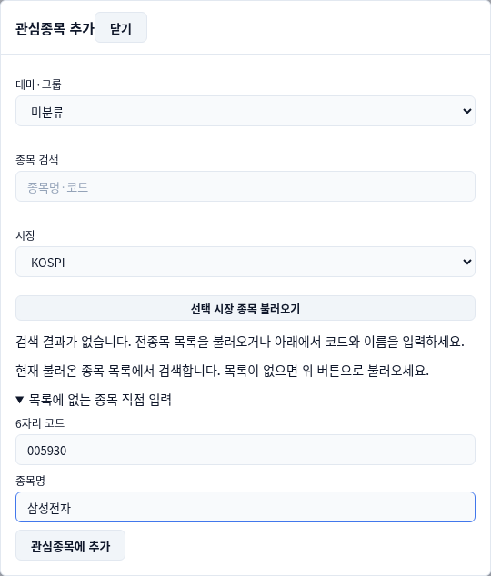
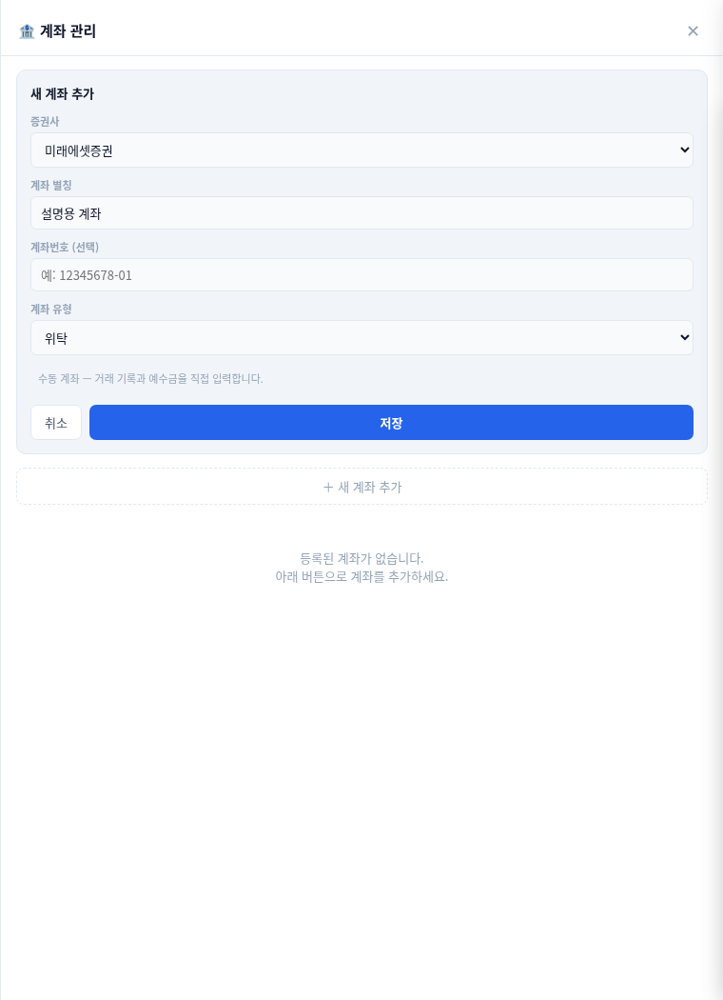
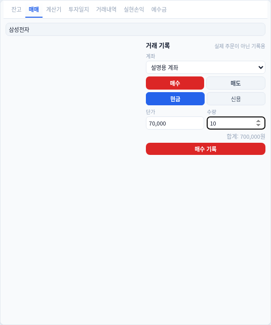
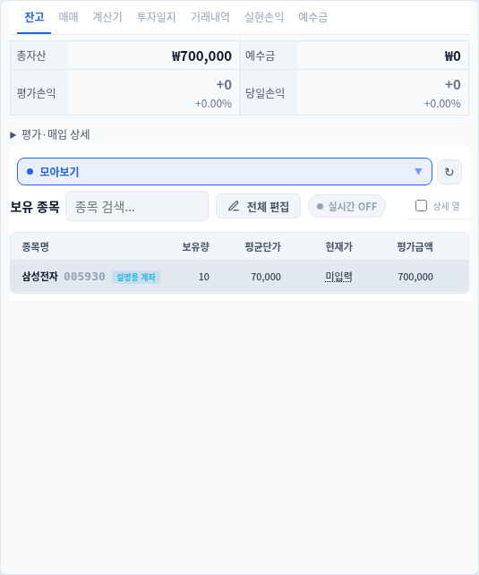
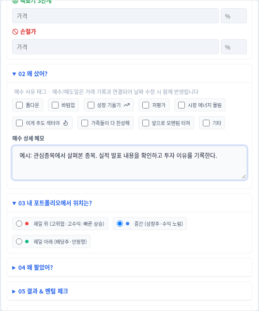

# StockBook 사용 설명서

관심 있는 종목을 모아 보고, 내 보유종목과 거래를 정리하고, 투자 이유를 일지로 남겨 보세요.

이 설명서는 **삼성전자를 관심종목에 넣고 → 매수한 내역을 기록하고 → 투자일지를 작성하는 순서**로 안내합니다. 화면의 ‘설명용 계좌’와 입력 금액은 사용법을 보여 주기 위한 예시입니다.

> **매매 화면은 거래를 기록하는 곳입니다.** ‘매수 기록’을 눌러도 증권사에 실제 주문이 나가지는 않습니다.

## 필요한 내용을 바로 찾으세요

- [처음 실행하기](#처음-실행하기)
- [화면 둘러보기](#화면-둘러보기)
- [1. 관심종목에 삼성전자 넣기](#1-관심종목에-삼성전자-넣기)
- [2. 내 계좌 등록하기](#2-내-계좌-등록하기)
- [3. 매수한 내역 기록하기](#3-매수한-내역-기록하기)
- [4. 투자 이유를 일지로 남기기](#4-투자-이유를-일지로-남기기)
- [매도한 내역과 손익 확인하기](#매도한-내역과-손익-확인하기)
- [계산기 사용하기](#계산기-사용하기)
- [뉴스와 일정 보기](#뉴스와-일정-보기)
- [시세 연결하기](#시세-연결하기)
- [화면을 내게 맞추기](#화면을-내게-맞추기)
- [내 기록을 백업하고 옮기기](#내-기록을-백업하고-옮기기)
- [자주 묻는 질문](#자주-묻는-질문)

## 처음 실행하기

### Windows에서 사용하기

[설치 파일 받기](https://github.com/mj94920/stockbook/releases/latest)에서 `Stock Book Setup`으로 시작하는 설치 파일을 내려받아 실행하세요. 설치를 마치면 StockBook을 엽니다.

처음 나타나는 연결 안내에서 시세 API를 설정할 수 있습니다. 먼저 프로그램을 둘러보고 싶다면 안내 창을 닫고 관심종목과 기록 기능부터 사용해도 됩니다. 연결 설정은 나중에 다시 할 수 있습니다.

### 설치 없이 둘러보기

[StockBook 웹 화면](https://mj94920.github.io/stockbook/)에서도 기록 화면을 사용할 수 있습니다. 증권사 연결과 앱 안에서 뉴스를 불러오는 기능은 Windows 앱을 이용하세요.

웹과 Windows 앱의 기록은 따로 저장됩니다. 다른 환경으로 옮길 때는 [백업과 복원](#내-기록을-백업하고-옮기기)을 사용합니다.

## 화면 둘러보기


왼쪽 **종합**을 누르면 가장 자주 쓰는 화면으로 돌아옵니다.

왼쪽 넓은 목록에서는 종목을 고르고, 오른쪽 위에서는 고른 종목을 살펴봅니다. 오른쪽 아래의 **잔고·매매·계산기·투자일지·거래내역·실현손익·예수금** 탭을 바꾸면 목록을 벗어나지 않고 작업할 수 있습니다.

왼쪽 메뉴 아래에는 **계좌**, **데이터**, **설정**이 있습니다. 계좌를 등록할 때는 계좌, 기록을 백업할 때는 데이터, 화면 색을 바꿀 때는 설정을 누르세요.

창이 작아 내용이 잘리면 패널 안을 스크롤하거나 창을 넓혀 보세요. 사이드바의 화살표로 메뉴를 접으면 작업 공간을 더 확보할 수 있습니다.

## 1. 관심종목에 삼성전자 넣기

**열 곳: 종합 → 관심종목 → ＋ 관심종목 추가**

1. 왼쪽 **종합**을 누릅니다.
2. 목록 위에서 **관심종목** 탭을 선택합니다.
3. **＋ 관심종목 추가**를 누릅니다.
4. 검색창에 `삼성전자` 또는 `005930`을 입력합니다.
5. 검색 결과에서 삼성전자를 눌러 추가합니다.

목록이 비어 있으면 시장에서 **KOSPI**를 고른 다음 **선택 시장 종목 불러오기**를 누르세요. 종목 목록 조회는 Windows 앱에서 사용할 수 있습니다.

### 검색으로 찾을 수 없다면

추가 창 아래의 **목록에 없는 종목 직접 입력**을 펼칩니다. 6자리 코드에 `005930`, 종목명에 `삼성전자`를 입력하고 **관심종목에 추가**를 누릅니다.



**추가하고 나면** 관심종목 목록에 삼성전자 행이 나타납니다. 그 행을 눌러 선택하면 오른쪽에 종목명이 표시됩니다. 시세를 받지 못한 상태에서는 가격이 비어 있을 수 있습니다.

### 종목이 많아졌을 때

목록 위의 **관심종목 이름·코드 필터**에 이름을 입력하면 등록된 종목 중에서 찾을 수 있습니다. 새로운 종목을 넣을 때는 필터 대신 **＋ 관심종목 추가**를 사용하세요.

**＋ 테마·그룹**으로 ‘반도체’ 같은 그룹을 만들고, 각 종목 옆의 선택 상자에서 그룹을 배정할 수 있습니다. 그룹 이름을 누르면 해당 종목만 보이고, **전체**를 누르면 모든 관심종목이 다시 나타납니다.

더 많은 항목을 보고 싶으면 **상세 열 보기**를 켜세요. 관심종목에서 제외하는 것은 보유 주식을 매도하는 것과는 다릅니다.

## 2. 내 계좌 등록하기

**열 곳: 왼쪽 아래 계좌**

여러 계좌를 구분하려면 먼저 계좌 이름을 등록합니다.

1. 왼쪽 **계좌**를 누릅니다.
2. 계좌 추가를 열고 사용하는 증권사를 선택합니다.
3. **계좌 별칭**에 알아보기 쉬운 이름을 적습니다. 여기서는 `설명용 계좌`로 적었습니다.
4. 계좌번호는 필요한 경우 입력하고, 위탁·ISA 등 계좌 유형을 선택합니다.
5. **저장**을 누릅니다.



**저장하고 나면** 계좌 목록에 방금 만든 이름이 보입니다. 거래를 기록할 때 이 계좌를 선택하면 됩니다.

계좌 등록은 내 기록을 나눠 담을 계좌를 만드는 작업입니다. 증권사 잔고를 자동으로 가져오려면 [시세 연결하기](#시세-연결하기)의 API 설정도 확인하세요.

예수금은 하단 **예수금** 탭에서 확인합니다. 수동 관리 계좌는 **계좌 관리**에서 예수금을 입력·수정하고, 자동 연동 계좌는 수신된 값을 확인합니다.

## 3. 매수한 내역 기록하기

**열 곳: 종합에서 종목 선택 → 하단 매매**

삼성전자를 **주당 70,000원에 10주 매수한 기록**을 입력해 보겠습니다. 아래 금액은 현재 시세가 아니라 설명용 예시입니다. 자신의 기록에는 실제 거래한 금액을 넣으세요.

1. 관심종목에서 **삼성전자**를 선택합니다.
2. 오른쪽 아래 **매매** 탭을 누릅니다.
3. 계좌에서 앞서 등록한 계좌를 선택합니다.
4. **매수**, **현금**을 선택합니다. 신용 거래를 기록할 때는 신용을 고릅니다.
5. **단가**에 `70,000`, **수량**에 `10`을 입력합니다.
6. 합계가 `700,000원`인지 확인하고 **매수 기록**을 누릅니다.



### 기록이 들어갔는지 확인하기

하단 **잔고**를 누르세요. 처음 등록한 종목이라면 삼성전자의 보유량이 **10주**, 평균단가가 **70,000원**으로 나타납니다. **거래내역**에서도 매수 기록 한 건을 확인할 수 있습니다.



이전에 같은 종목을 보유했다면 이번 수량이 더해지고 평균단가가 다시 계산됩니다. 선택 계좌의 저장된 예수금에도 기록이 반영될 수 있습니다.

> 같은 매수를 한 번 더 입력하면 수량도 한 번 더 늘어납니다. 이미 잔고에 반영한 거래를 중복으로 기록하지 마세요.

현재가를 아직 받지 못했다면 평가금액·평가손익보다 **보유 수량과 평균단가가 맞는지** 먼저 확인하세요.

### 호가를 이용해 단가 넣기

호가가 수신된 상태에서는 가격을 눌러 기록 단가에 넣을 수 있습니다. 실제 체결 가격과 다를 수 있으니 저장 전에 단가를 확인하세요. **호가 미수신**이 나오면 직접 확인한 거래 가격을 입력하면 됩니다.

## 4. 투자 이유를 일지로 남기기

**열 곳: 하단 투자일지 또는 왼쪽 투자일지**

매수 기록을 저장하면 일지 초안이 만들어질 수 있습니다. 목록에서 해당 초안을 열어 ‘왜 샀는지’를 이어 적어 보세요.

1. **투자일지**를 엽니다.
2. 작성할 초안을 편집하거나 새 일지를 작성합니다.
3. **매수일·종목명·매도/매수**를 확인합니다.
4. 가격과 수량을 넣고, 매수 이유나 메모를 적습니다.
5. **저장**을 누릅니다.



처음에는 아래 세 가지부터 남겨도 좋습니다.

- **매수 이유:** 어떤 사실을 보고 이 종목을 골랐는가?
- **확인할 조건:** 앞으로 무엇을 보고 판단할 것인가?
- **결과와 교훈:** 처음 생각과 실제 결과는 어떻게 달랐는가?

예를 들어 “실적 발표 내용을 확인하고 투자 이유를 기록한다”처럼 나중에 다시 읽어도 판단 근거를 떠올릴 수 있게 적습니다.

추가 매수가 있으면 **추매 행 추가**, 매도를 마쳤으면 매도일과 결과 항목을 활용하세요. 목표가·손절가를 적을 수도 있습니다. 일지에 목표 가격을 적는 것만으로 자동 주문이 예약되지는 않습니다.

저장 후에는 목록에서 일지를 다시 열어 내용이 남아 있는지 확인합니다. 연결된 거래의 날짜를 고쳤다면 **거래내역**의 날짜도 함께 살펴보세요.

## 매도한 내역과 손익 확인하기

**열 곳: 하단 매매 → 매도**

매수 때처럼 종목과 계좌를 확인하고, **매도**를 고른 뒤 실제 매도 단가·수량을 입력합니다. **매도 기록**을 누르고 다음 세 곳을 확인하세요.

1. **잔고:** 매도한 수량만큼 줄었는지 확인합니다.
2. **거래내역:** 매도 가격과 수량이 맞는지 확인합니다.
3. **실현손익:** 저장된 매도 기록에 따른 손익을 확인합니다.

보유 수량보다 많이 입력하면 기록이 거절될 수 있습니다. 이때는 등록된 보유 수량과 현금·신용 구분을 확인하세요.

### 거래 기록을 표로 받기

**거래내역 → CSV 내보내기**를 누르면 거래 기록을 표 파일로 받을 수 있습니다. 스프레드시트에서 살펴볼 때 사용하세요. 프로그램 전체 기록을 옮길 때는 CSV 대신 [백업 JSON](#내-기록을-백업하고-옮기기)을 사용합니다.

## 계산기 사용하기

**열 곳: 하단 계산기**

### 추가 매수 후 평균단가 알아보기

**물타기 계산기**에 기존 평균단가·보유 수량과 추가 매수 가격·수량을 입력합니다.

예를 들어 기존에 **70,000원 × 10주**를 보유하고 **60,000원 × 10주**를 더 매수한다면:

```text
기존 매수금액 700,000원 + 추가 매수금액 600,000원
───────────────────────────────────────────── = 새 평균단가 65,000원
                  총 20주
```

계산 결과를 확인한 뒤 실제로 거래했다면 **매매**에서 따로 기록합니다. 계산기 입력만으로 보유 수량이 바뀌지는 않습니다.

### 적립과 복리 계산하기

**복리 계산기**에서 초기 원금, 월 수익률, 투자 기간, 월 추가 납입, 시작일을 입력하고 **계산**을 누릅니다.

월 수익률을 1로 넣으면 월 1%를 가정하는 식입니다. 기간 단위는 개월인지 확인하세요. 여러 조건을 비교할 때는 **초기화**로 입력을 지우고 다시 계산하면 됩니다. 결과는 입력한 수익률이 이어진다고 가정한 값입니다.

## 뉴스와 일정 보기

### 종목 뉴스를 찾아보기

**열 곳: 왼쪽 뉴스·시황**

1. 종목 입력창에서 국내 종목명 또는 6자리 코드를 입력·선택합니다.
2. **종목 뉴스 보기**를 누릅니다.
3. 기사 목록에서 읽을 항목을 누릅니다.
4. 더 읽으려면 원문으로 이동합니다.

받은 기사 중에서 찾을 말이 있으면 **기사 검색**에 입력하세요. 기사 제목·요약·출처를 기준으로 목록을 좁힙니다. 인터넷 전체 기사를 새로 검색하는 입력창은 아닙니다.

**시장뉴스**로 전환하면 시장 전체 뉴스를 살펴볼 수 있고, **새로고침**으로 다시 요청할 수 있습니다. 앱 안으로 기사를 불러오려면 Windows 앱을 이용하세요. 웹 화면에서는 외부 사이트 바로가기를 사용할 수 있습니다.

### 일정 확인하기

왼쪽 **캘린더**를 누르면 시장 일정 센터가 열립니다. 날짜와 일정, 경제지표 항목을 골라 확인하세요. 투자 판단에 중요한 발표 일정은 원래 발표처에서도 시간과 내용을 확인하는 것이 좋습니다.

## 시세 연결하기

수동으로 기록을 정리하는 데에는 API 키가 필요하지 않습니다. 한국투자증권의 시세·계좌 조회를 이용하려면 아래 순서로 연결합니다.

**열 곳: 설정 → API 연결 → 한국투자증권**

1. KIS Developers에서 본인의 APP Key와 Secret을 준비합니다.
2. StockBook에서 **한국투자증권** 카드를 누릅니다.
3. 발급받은 키와 필요한 계좌 정보를 입력합니다.
4. 저장한 뒤 종목의 시세와 연결 상태를 확인합니다.

키는 비밀번호처럼 보관하고, 화면을 공유할 때 가려 주세요. 다른 증권사를 선택했을 때도 같은 기능을 쓸 수 있는지는 해당 연결 안내를 확인합니다.

시세가 비어 있으면 연결 상태와 마지막 조회 시각을 살펴보세요. 실시간 구독 종목은 수에 제한이 있어, 기본적으로 **보유종목 → 선택 종목 → 관심종목 → 기타** 순으로 우선합니다. 우선순위는 **설정 → 시세·실시간**에서 조정할 수 있습니다.

## 화면을 내게 맞추기

**열 곳: 설정 → 화면·테마**


- **시스템 자동:** 컴퓨터의 밝기 설정에 맞춥니다.
- **라이트 / 다크:** 밝은 화면 또는 어두운 화면으로 고정합니다.
- **넓게 / 기본 / 조밀하게:** 글 주변의 간격과 버튼 높이를 조절합니다.

화면이 답답하면 창을 넓히거나 사이드바를 접어 보세요. 작은 창에서는 각 패널 안에도 스크롤이 생깁니다.

화면 배치가 어색해졌다면 **데이터 → 패널 레이아웃 초기화**로 배치를 되돌릴 수 있습니다. 이 버튼은 투자 기록을 지우는 용도가 아닙니다.

## 내 기록을 백업하고 옮기기

### 백업 파일 만들기

**열 곳: 왼쪽 데이터 → 백업**


1. **데이터**를 누릅니다.
2. **데이터 백업 (JSON 다운로드)** 옆 **백업**을 누릅니다.
3. 내려받은 `stockbook_backup_날짜_시간.json` 파일을 확인합니다.
4. 다른 저장 장치 등에도 복사해 둡니다.

중요한 기록을 많이 추가했거나 PC를 바꾸기 전에 백업해 두세요. 파일에는 계좌 별칭·보유종목·일지 등이 들어 있으므로 개인 문서처럼 보관합니다.

### 다른 PC에서 복원하기

> **복원하면 현재 프로그램의 기록이 백업 파일 내용으로 바뀝니다.** 두 기록을 자동으로 합치지는 않습니다.

1. 옮길 PC에도 StockBook을 설치하고 백업 파일을 복사합니다.
2. 그 PC에 이미 기록이 있다면 먼저 별도 백업합니다.
3. **데이터 → 복원**에서 옮겨 온 JSON 파일을 선택합니다.
4. 표시되는 종목·거래·일지 수를 확인하고 복원을 승인합니다.
5. 잔고와 일지를 열어 내용이 옮겨졌는지 확인합니다.

증권사 연결 설정은 따로 확인하세요. JSON 백업만으로 API 키까지 복구되는 것은 아닙니다.

## 자주 묻는 질문

### 관심종목에 추가했는데 잔고에는 없어요

관심종목은 지켜볼 목록이고 잔고는 실제 보유 기록입니다. 보유 내역을 기록하려면 **매매**에서 매수 내역을 입력하세요.

### 매수 기록을 눌렀는데 증권사 계좌에는 변화가 없어요

StockBook의 매매 화면은 기록용입니다. 실제 주문은 이용 중인 증권사에서 처리합니다.

### 잔고 수량이 예상보다 많아요

같은 매수를 두 번 기록했는지 **거래내역**을 확인하세요. 기록을 수정하기 전에는 백업을 남겨 두면 좋습니다.

### 가격이 ‘--’이거나 ‘호가 미수신’으로 나와요

아직 가격 자료를 받지 못한 상태입니다. 종목코드, 시세 연결과 마지막 수신 시각을 확인하세요. 표시가 비어 있다는 이유로 실제 가격을 0원으로 입력하지 마세요.

### 차트·AI 분석·규칙 신호에 ‘데이터 없음’이 나와요

해당 영역에 표시할 자료가 연결되지 않은 상태입니다. 관심종목·거래·일지 같은 기록 기능은 별도로 사용할 수 있습니다.

### 예수금이 증권사와 달라요

선택한 계좌, 수동으로 입력한 예수금, 기록한 매수·매도, 마지막 동기화 시각을 확인하세요. 실제 거래 가능한 금액은 증권사에서 확인합니다.

### 웹과 Windows 앱에 같은 기록이 안 나와요

각 환경에 따로 저장됩니다. 기록을 옮길 때는 백업·복원을 사용하세요. 브라우저의 사이트 데이터를 지우기 전에도 백업해야 합니다.

### ‘시작 시 자동 로그인’은 무엇인가요?

키를 저장해 두었다면 시작할 때 연결 안내 창을 건너뛰도록 하는 설정입니다. **설정 → 일반**에서 바꿀 수 있습니다.

### 일지를 편집하거나 저장했는데 화면이 멈춘 것 같아요

일부 화면에서 일지 입력란을 갱신하는 오류가 확인됐습니다. 저장한 뒤 입력란이 그대로 있어도 같은 내용을 다시 저장하기 전에 목록에서 반영 여부를 확인하세요. 문제가 계속되면 기록을 백업하고 당시 화면을 알려 주세요.

### 오류를 어떻게 알려드리면 되나요?

어느 메뉴에서 무엇을 눌렀는지, 기대한 결과와 실제로 나온 화면을 알려 주세요. 화면을 첨부한다면 계좌번호·API 키 등 개인 정보는 가립니다.
