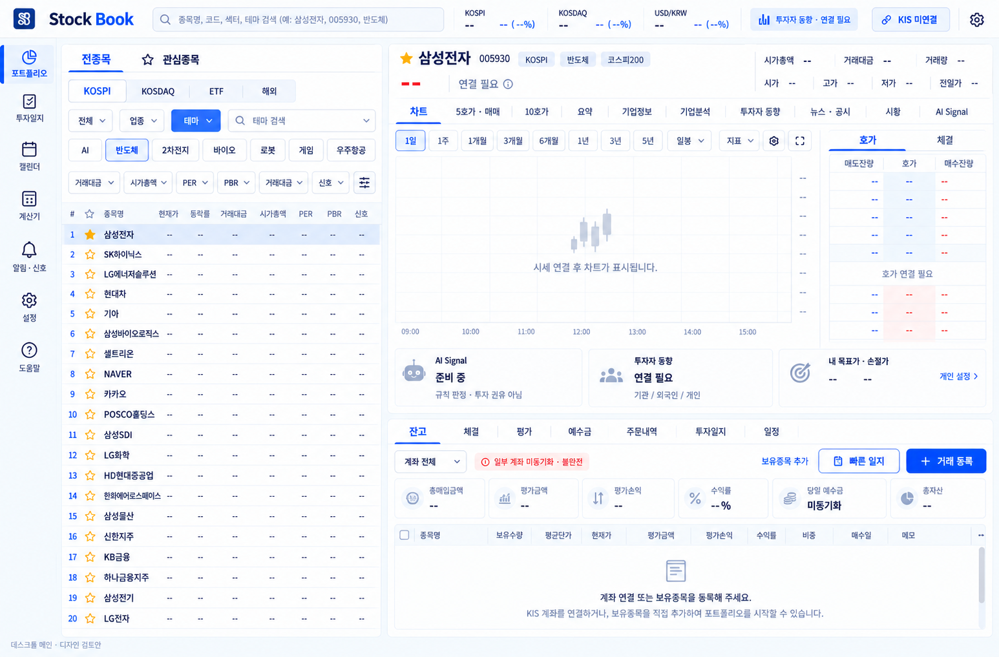

# 승인된 데스크톱 디자인·브랜드 원본

2026-10-21 새 작업방 이관을 위해 원본 파일을 보존한다. 이 폴더는 실행 코드가 아니다. [작업 인계서](../../HANDOFF-DESKTOP-2026-10-21.md)를 먼저 읽는다.

## 승인 근거와 적용 우선순위

사용자 발언: **“일단 개선할 건 나중에 개선하더라도 목업3종은 통과 / 로고도 통과 / 나머지는 순서대로”** (2026-10-19 대화).

1. 목업 3종과 선택한 로고가 디자인 출발점이다. 사용자가 이후 정정한 화면 구성은 아래 기준이 우선한다.
2. 좌측 종목창 유지, 좌우 약 40:60. 상단 선택 종목 가격·차트·호가. 하단 작업 탭(잔고·거래내역·투자일지)과 AI 분석·규칙 신호를 동시에 표시한다. AI 분석과 규칙 신호는 다른 영역이다. 일지를 별도 전체 화면으로 대체하거나 AI/신호를 하나의 준비 중 카드로 축소하지 않는다.
3. 라이트가 시각 기준이지만 기본 다크 및 기존 사용자 테마 설정은 보존한다. 거래 등록 > 빠른 일지 > 보유종목 추가 순서로 강조한다.
4. 이미지의 모든 필터·차트·상태가 구현 승인된 것은 아니다. 원래 목업의 미연결 설명과 실제 데이터 연결 상태를 혼동하지 않는다. 데이터/엔진이 없어도 영역과 확인 흐름을 확보하고 `데이터 없음·판정 대기`를 명시한다. 신규 계약/엔진을 UI에서 추정 구현하지 않는다.
5. [실제 구현 검토 캡처](../desktop-main-v2-review/)는 #83 브라우저 실행 자료이며 승인 원본이 아니다. 이후 사용자 로컬 화면에서 큰 여백·작은 글씨·낮은 정보 밀도 문제가 제기돼 개선이 남아 있다.

## 승인 목업 3종

- [메인](mockups/01-main.png)
- [투자일지](mockups/02-journal.png)
- [계좌·예수금](mockups/03-accounts.png)



계좌 목업의 내부 정책 설명 배너는 제품 문구로 옮기지 않는다. 통화별 합산·D+2·동기화 상태 등은 시스템 계약 검토 없이 새로 확정하지 않는다. 테마/PER 필터·차트/일봉·수급 등 미구현 기능은 별도 범위를 확인한다.

## 승인 브랜드

- 이름은 **Stock Book**으로 띄어 쓴다.
- 선택한 아이콘은 파란 정사각형의 추상 SB 형상이다. 기존 책/캔들/상승 차트 로고로 되돌리지 않는다.
- [벡터 원본](brand/source/): icon, symbol, background, wordmark, light/dark lockup.
- [크기별 PNG](brand/png/): 16~1024px 아이콘과 워드마크/락업.
- [Windows ICO](brand/stock-book.ico): 여러 크기 포함.
- [선택 기준 시트](brand/reference/approved-brand-reference.png), [아이콘 기준](brand/reference/approved-icon.png).
- [사용 예시](brand/reference/application-reference.png)는 브랜드 적용 참고일 뿐 해당 이미지의 메뉴·화면 구성을 승인한 것이 아니다.

벡터는 승인 이미지를 추적한 경로이며 원래 글꼴의 정확한 윤곽/라이선스 증빙이 아니다. 큰 크기에서 곡선 정리가 더 필요할 수 있다. 원본 wordmark/lockup에 고정된 어두운 fill이 있어 다크 배경에 그대로 쓰지 않는다. #83의 인라인 currentColor 대응을 재사용한다. 원본을 몰래 다시 디자인하지 않는다.

## 원본 검증

`SHA256SUMS.txt`에는 이 폴더의 목업·SVG·PNG·ICO 원본 해시가 있다. 예:

```bash
cd docs/design/desktop-main-v2-approved
sha256sum -c SHA256SUMS.txt
```

원본은 이관 직전 `/workspace/deliverables/stock-book-desktop-v2/`와 `/workspace/deliverables/stock-book-brand-approved/`에서 바이트 동일하게 복사했다. 이 절의 로컬 경로는 이력이며 다음 환경이 접근할 위치는 본 저장소 상대 경로다. 모바일 초안과 승인되지 않은 코드 목업은 섞지 않았다.
